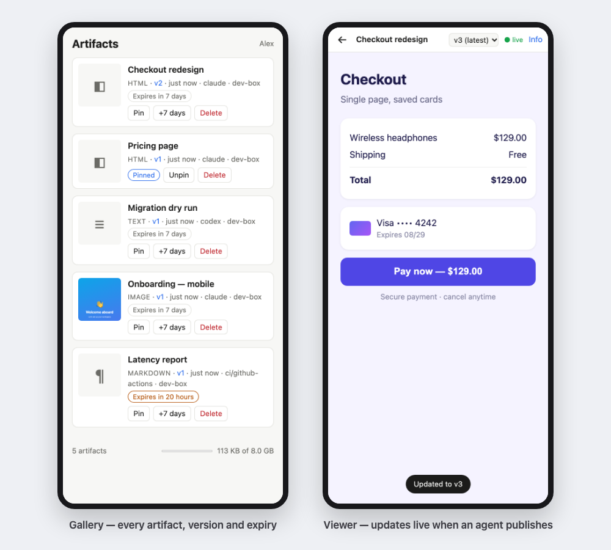
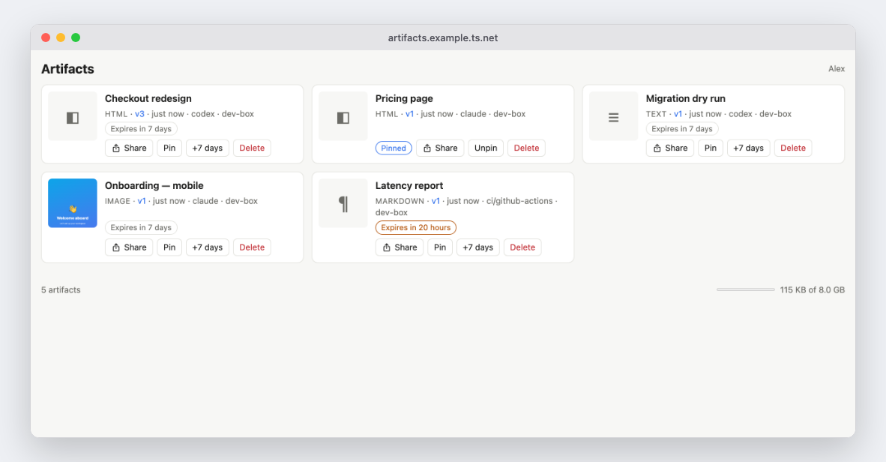
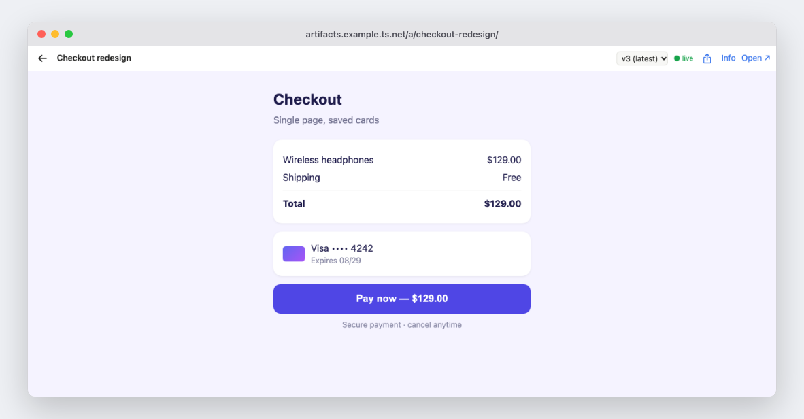

# tailnet-artifacts

Self-hosted, versioned artifact links for AI agents. An agent publishes an HTML
mockup, a built site, a screenshot or a Markdown note; you get a link you can
open on any device in your [Tailscale](https://tailscale.com) tailnet. When the
agent publishes a new version, the open page updates by itself.

Think "Claude Artifacts", but for any agent or tool, on your own hardware, with
no domain, certificate or login provider to set up.



<details>
<summary>On a desktop</summary>





</details>

> **Status: early (0.x).** It runs a real homelab day to day, but expect breaking
> changes before 1.0. Built for one person or a small team and their own agents:
> everyone on the tailnet can view every artifact (see [Security](#security)).

- **One small Node.js process.** No database. One runtime dependency (`marked`).
- **Versions.** Every publish is an immutable version. Links to the latest
  version follow new publishes; links to a specific version never change.
- **Live reload.** The viewer switches to a new version as soon as it lands.
- **Expiry.** Artifacts expire 7 days after their last publish by default.
  Pin the ones you want to keep.
- **Works with any agent.** Publishing is a CLI call that prints JSON. A free-form
  `--by` label records which agent or tool published each version.
- **Isolation without extra domains.** Artifact content runs sandboxed in an opaque
  origin, so it cannot act on the gallery or with your identity.

## How it works

```
 agent / CI / you                         phone, laptop (tailnet)
       │  artifacts publish ./mockup.html          ▲
       │  (HTTPS + bearer token)                   │ https://artifacts.<tailnet>.ts.net
       ▼                                           │
 ┌─────────────────── tailscale serve (TLS, tailnet-only) ─────────────────┐
 │                  tailnet-artifacts on 127.0.0.1:8790                    │
 │   gallery · viewer shell · version history · raw content (sandboxed)    │
 │   data/artifacts/<id>/meta.json + v/<n>/…          hourly expiry sweep  │
 └─────────────────────────────────────────────────────────────────────────┘
```

| Link | What it shows |
| --- | --- |
| `/` | Gallery, newest first |
| `/a/<id>/` | Latest version in a viewer with version picker and live reload |
| `/a/<id>/?v=3` | Version 3 in the viewer |
| `/a/<id>/v/3/` | Version 3 raw, without the toolbar (never changes) |
| `/a/<id>/latest/` | The latest version raw (redirects to `/v/<n>/`) |
| `/a/<id>/info` | Version history with notes, sources and sizes |

IDs are a slug of the name plus a 10-character random suffix (about 51 bits),
e.g. `checkout-redesign-k3f9x2m8q1`.

## Set up the server

**Before you start**, in the [Tailscale admin console](https://login.tailscale.com/admin):
enable **HTTPS certificates** (DNS page), note your **tailnet DNS name**
(`something.ts.net`, also on the DNS page), and for Docker create an **auth key**
(Settings → Keys). [docs/platforms.md](docs/platforms.md#before-you-start) explains each.

Then follow the recipe for your machine:

| Platform | Recipe |
| --- | --- |
| Proxmox VE | [one-command LXC script](docs/platforms.md#proxmox-ve-lxc) |
| Synology DSM | [Container Manager](docs/platforms.md#synology-dsm-container-manager) |
| Any Docker host (Linux server, Raspberry Pi, Unraid, TrueNAS) | [Docker Compose with a Tailscale sidecar](docs/platforms.md#any-docker-host) |
| Linux with systemd | [docs/deploy.md](docs/deploy.md) |

Each recipe ends with a **publish token** for the next step.

## Set up a publishing machine

On each machine where agents run, you need **Node.js 22+**, **git** and
**Tailscale** signed in to the same tailnet. Then:

```sh
npm install -g git+https://github.com/vladgurovich/tailnet-artifacts.git#v0.5.1
artifacts login https://artifacts.<tailnet>.ts.net   # paste the token; it is checked and saved
artifacts skill install                              # teaches your agents to publish (see below)
artifacts doctor                                     # checks server, token, versions, skill, browser
```

`login` saves the address and token in `~/.config/tailnet-artifacts/`, readable only
by you. In CI, set `ARTIFACTS_URL` and `ARTIFACTS_TOKEN` instead, or pipe the token
into `artifacts login <url> --token-stdin`. The first `doctor` run downloads
Playwright to check the screenshot browser; add `--skip-browser` to skip that.

For `artifacts screenshot`, install Chromium once with the command `doctor` prints
(on Linux, `npx -y playwright@1.65.0 install --with-deps chromium`).

**Agents:** `artifacts skill install` installs an [Agent Skill](https://agentskills.io)
that teaches Claude Code, Codex and other skill-aware agents to publish visual work
and reply with the link. See [docs/agents.md](docs/agents.md).

## Publish

```sh
artifacts publish ./mockup.html --name "Login redesign" --by codex
artifacts publish ./dist --to login-redesign-k3f9x2m8q1 --note "tighter spacing"
artifacts publish ./screenshot.png --name "Checkout bug" --ttl 30d
artifacts publish ./notes.md --keep
artifacts screenshot http://localhost:5173 --mobile --name "Home (mobile)"
```

`publish` prints JSON. `warnings` lists problems that don't stop the publish, such
as root-absolute asset paths in a built app (they're also printed to stderr):

```json
{
  "id": "login-redesign-k3f9x2m8q1",
  "name": "Login redesign",
  "version": 2,
  "kind": "html",
  "expiresAt": "2026-11-19T18:00:00.000Z",
  "links": {
    "latest": "https://artifacts.example.ts.net/a/login-redesign-k3f9x2m8q1/",
    "version": "https://artifacts.example.ts.net/a/login-redesign-k3f9x2m8q1/?v=2",
    "raw": "https://artifacts.example.ts.net/a/login-redesign-k3f9x2m8q1/v/2/",
    "info": "https://artifacts.example.ts.net/a/login-redesign-k3f9x2m8q1/info"
  },
  "warnings": []
}
```

| Option | Meaning |
| --- | --- |
| `--name "Title"` | Title shown in the gallery (new artifacts, or rename on `--to`) |
| `--to <id>` | Publish a new version of an existing artifact |
| `--note "text"` | What changed, shown in the version history |
| `--by <label>` | Free-form source: `codex`, `claude`, `ci/github-actions`, a person… Defaults to `ARTIFACTS_BY` |
| `--ttl 30d` / `--keep` | Expire this long after the last publish (`m`, `h`, `d`, `w`) / never expire |
| `--entry page.html` | Entry page for a directory that has several `.html` files and no `index.html` |
| `--expected-version N` | Reject the publish if someone else published after version N |
| `--url-only` | Print only the latest link |
| `--include-hidden` | Also publish dotfiles (`.env`, `.npmrc`, …) and `node_modules`, which are skipped by default |

`screenshot <url>` takes a full-page screenshot with Playwright and publishes it.
Options: `--mobile` (390×844), `--viewport 1440,900`, `--no-full-page`,
`--wait 1000` (milliseconds), plus any publish option. It uses the Playwright
version this package is tested with; `ARTIFACTS_PLAYWRIGHT` overrides it.

**What can be published:** a single HTML file; a directory (entry `index.html`, or
its only `.html` file); an image (PNG, JPG, GIF, WebP, AVIF, SVG); a PDF; a
Markdown file (rendered); a text file such as `.log`, `.json`, `.csv` or source
code (shown inline); or any other single file (offered as a download). Size and
file-count limits are checked before anything is read.

**Built apps (Vite, CRA, Next, …)** must use relative asset paths, because an
artifact lives under `/a/<id>/v/<n>/`, not at the site root: `vite build --base ./`,
`"homepage": "."` for CRA, or `output: 'export'` with `assetPrefix: './'` for Next.

**Sandbox limits.** Artifacts run in an opaque origin, so `localStorage`,
`sessionStorage`, IndexedDB and cookies throw `SecurityError`. Apps that need them
must catch the error or keep state in memory.

**Errors.** On failure the CLI prints `{"error": "...", "message": "..."}` to stderr
and exits with: `2` usage (including a missing local file), `3` auth or permission,
`4` version conflict, `5` artifact not found or expired on the server, `6` too large
or storage full, `7` network, `1` anything else. `doctor` exits `1` if any check
fails. Every command accepts `--help`.

## Manage artifacts

Everyone can **Share** an artifact from its gallery card or the viewer toolbar: it
opens the system share sheet (phones, Safari) or copies the link. Recipients need
access to your tailnet to open it. Owners (Tailscale logins in `ARTIFACTS_OWNERS`)
also get **Pin**, **+7 days** and **Delete** buttons in the gallery and on each
artifact's info page. Tokens can do
the same within their scope through the [HTTP API](docs/configuration.md#http-api).

## Configuration

Server settings (data directory, owners, TTLs, size limits), tokens and scopes,
expiry rules, client settings and the HTTP API are in
[docs/configuration.md](docs/configuration.md).

## Security

The full model is in [docs/security.md](docs/security.md). In short:

- Anyone who can reach the machine on your tailnet can **view** every artifact.
  Restrict the machine with tailnet access rules, and never enable Funnel on it.
- Publishing needs a token. `publish` tokens (the default) can only change their
  own artifacts; `admin` tokens can change any.
- Artifact content is sandboxed: its scripts cannot touch the gallery, your
  identity or your cookies. Artifacts can read each other if they know the URL.
- Built for trusted publishers (your own agents), not for strangers' uploads.

## Development

```sh
npm install
npm test                          # unit, HTTP and CLI tests (node:test)
npx playwright install chromium   # once, for the browser tests
npm run test:browser              # gallery, viewer and screenshot tests in headless Chromium
npm run coverage                  # both suites with a coverage report
npm start                         # serve with ./data
```

Playwright is a dev dependency only; production installs (`npm ci --omit=dev`) and
the CLI (`npm install -g`) don't download it.

The code is small on purpose: `src/store.js` (storage, versions, expiry),
`src/server.js` (HTTP), `src/render.js` (pages), `src/cli/` (publishing, login,
doctor), `src/identity.js` and `src/urls.js` (extension points).
`test/review.test.js` holds regression tests for the v0.2.0 security review.
See [CONTRIBUTING.md](CONTRIBUTING.md).

## License

[MIT](LICENSE). Security reports: [SECURITY.md](SECURITY.md).

Not affiliated with or endorsed by Tailscale Inc. "Tailscale" and "tailnet" refer
to their product; this project just runs on it.
